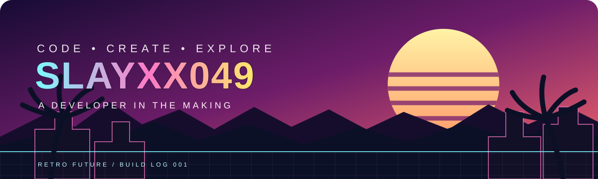
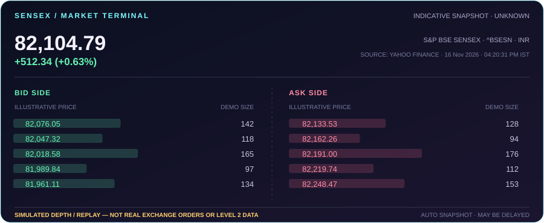
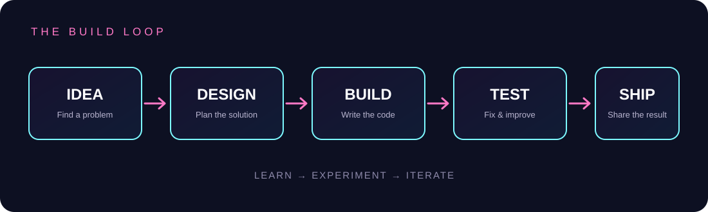

<!-- Vice City-inspired developer homepage for slayxx049. Keep claims factual. -->

  

<h1 align="center">HEY, I'M SLAYXX049</h1>

  <b>CODE • EXPERIMENT • BUILD • REPEAT</b> 
  First-year B.Tech student in Computer Science &amp; Engineering (AI/ML). 
  Exploring software development, AI/ML, cybersecurity, and practical tools.

  
  
  
  

Somewhere between late-night ideas, terminal windows, and the next commit.

---

## PLAYER PROFILE

<table>
<tr>
<td width="50%" valign="top">

**CURRENT ROLE**  
B.Tech CSE (AI/ML) student

**AREAS I EXPLORE**  
AI / ML · Software · Cybersecurity

</td>
<td width="50%" valign="top">

**HOW I WORK**  
Learn by building, testing, and iterating.

**WHAT I BUILD TOWARD**  
Practical projects that connect code with real use cases.

</td>
</tr>
</table>

## GITHUB STATS // PLAYER STATUS

  
  

## FEATURED BUILD // AI JOB FINDER

A Python-based project for exploring job roles and matching opportunities with a user's profile, supported by job-discovery and scoring components.

  
  

## OTHER BUILDS & EXPERIMENTS

<table>
<tr>
<td width="50%" valign="top">

### YOUTUBE AUTOMATION

An in-progress workflow for turning video ideas into assembled content, with scripting, narration, and video-processing components.

</td>
<td width="50%" valign="top">

### PORTFOLIO / BUILD LOG

A personal website documenting projects, coding experiments, and the process of building.

</td>
</tr>
<tr>
<td width="50%" valign="top">

### DAILY MINI BYTES

A web project focused on news, blogs, and technology content.

</td>
<td width="50%" valign="top">

### MORE EXPERIMENTS

Prototypes, small builds, and technical experiments across my repositories.

</td>
</tr>
</table>

## LIVE MARKET WATCH

  

Market-data snapshot refreshed by GitHub Actions approximately every 5 minutes during its weekday schedule. The dashboard can request the latest available provider snapshot every 60 seconds after its optional Worker feed is configured. Provider delays and caching may apply. The red/green depth ladder is simulated, not real exchange orders or Level 2 data. Educational display only.

<a href="docs/SENSEX-MINUTE-FEED.md">OPTIONAL 60-SECOND DATA FEED SETUP</a>

## THE TOOLKIT

  
  

Languages and tools I've worked with across coursework and projects.

## HOW I BUILD

## CONTRIBUTION ACTIVITY

  

  

---

  <b>GOT AN IDEA WORTH BUILDING?</b> 
  Let's connect, exchange ideas, and make something useful.

  
  

Made of curiosity, commits, and a little Vice City neon.

