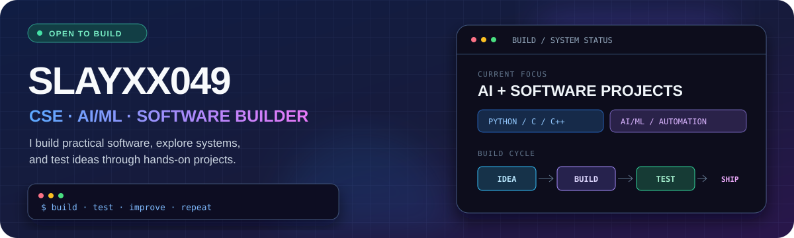
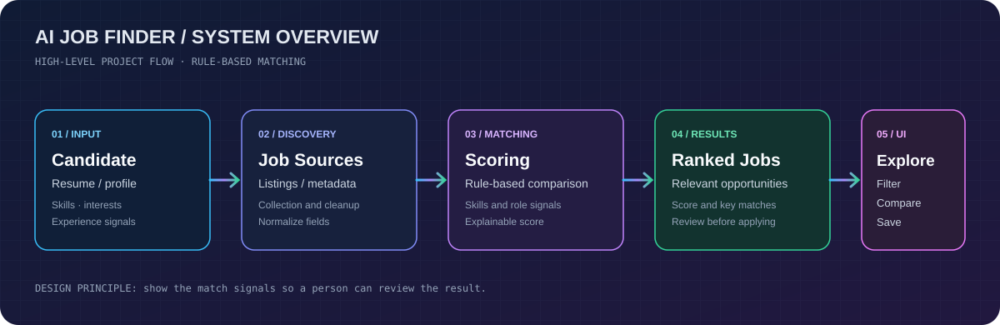

<!-- Checkpoint 1: reproduce the visual structure of the reference profile with original assets and accurate project details. -->

  

  
  
  
  

<table>
  <tr>
    <td align="center" width="20%">
      ACADEMIC TRACK 
      <strong> CSE </strong> 
      AI / ML
    </td>
    <td align="center" width="20%">
      TOOLKIT 
      <strong>07</strong> 
      languages &amp; tools
    </td>
    <td align="center" width="20%">
      FOCUS 
      <strong>AI +</strong> 
      software projects
    </td>
    <td align="center" width="20%">
      BUILD STYLE 
      <strong>HANDS-ON</strong> 
      learn by building
    </td>
    <td align="center" width="20%">
      MODE 
      <strong>ITERATE</strong> 
      test · improve
    </td>
  </tr>
</table>

## FLAGSHIP / AI JOB FINDER

A Python-based job-discovery application that collects opportunities and compares them against a candidate profile. Its matching logic uses explicit, rule-based signals so the result can be inspected rather than treated as an unexplained AI decision.

  

  

Project focus: job discovery · profile matching · explainable scoring · ranked results

## SELECTED WORK

<table>
  <tr>
    <td width="50%" valign="top">
      <h3>AI JOB FINDER</h3>
      PYTHON · STREAMLIT · SCORING
      
Job discovery and rule-based profile matching, presented through a simple application interface.

      <a href="https://ai-j0b-finder.streamlit.app/">OPEN PROJECT →</a>
    </td>
    <td width="50%" valign="top">
      <h3>YOUTUBE AUTOMATION AGENT</h3>
      PYTHON · NODE.JS · VIDEO TOOLING
      
An in-progress workflow for assisting video production, from content preparation to processing and assembly.

      <a href="https://github.com/slayxx049/my-ai-agent">EXPLORE REPOSITORY →</a>
    </td>
  </tr>
  <tr>
    <td width="50%" valign="top">
      <h3>PORTFOLIO / BUILD LOG</h3>
      WEB · INTERACTION · PROJECT JOURNAL
      
A personal site documenting projects, coding experiments, and the process behind each build.

      <a href="https://slayxx049.github.io/build-port/">VISIT PORTFOLIO →</a>
    </td>
    <td width="50%" valign="top">
      <h3>APP LOCKER</h3>
      ANDROID · APP PROTOTYPE
      
An app-lock prototype exploring app selection and local device authentication flows.

      <a href="https://github.com/slayxx049/applocker">VIEW REPOSITORY →</a>
    </td>
  </tr>
</table>

## GITHUB / ACTIVITY

  
  

  

## STACK

  
  

HTML · Python · Git · GitHub · C++ · C · MATLAB

  

  
  

BUILD · TEST · LEARN · REPEAT

