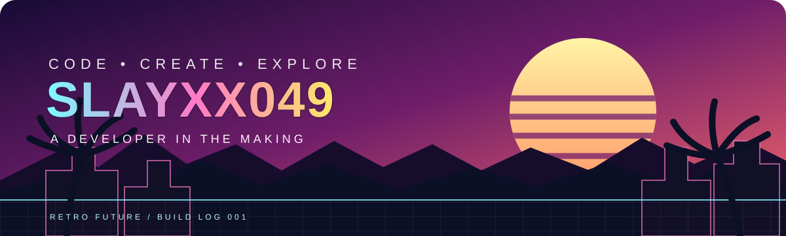
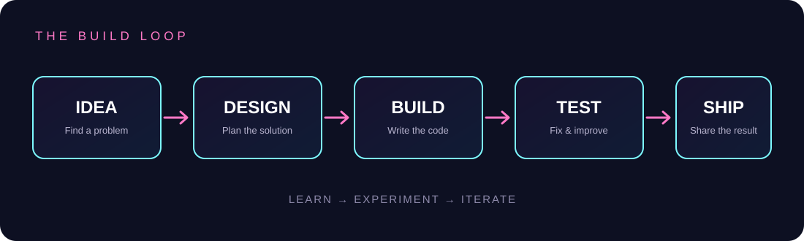

<!--
  GitHub profile dashboard for slayxx049.
  Personal projects and skills only; no invented metrics or achievements.
-->

  

<h1 align="center">HEY, I'M SLAYXX049</h1>

  <b>CODE • EXPERIMENT • BUILD • REPEAT</b> 
  CSE student exploring software development, AI/ML, and ethical cybersecurity.

  
  

---

<table>
<tr>
<td width="34%" valign="top">

<h3>PLAYER PROFILE</h3>

**Role**  
CSE Student

**Interests**  
AI / ML · Cybersecurity · Software

**Approach**  
Learn by building and testing.

**Current focus**  
Turning ideas into working projects.

</td>
<td width="66%" valign="top">

<h3>GITHUB SNAPSHOT</h3>

  
  

</td>
</tr>
</table>

## THE TOOLKIT

  
  

## THINGS I'VE PUT TOGETHER

<table>
<tr>
<td width="50%" valign="top">

### AI JOB FINDER

A Python-based resume and job-role exploration prototype.

</td>
<td width="50%" valign="top">

### DAILY MINI BYTES

A news, blog, and technology platform.

</td>
</tr>
<tr>
<td width="50%" valign="top">

### PORTFOLIO / BUILD LOG

A personal website documenting coding and building experiments.

</td>
<td width="50%" valign="top">

### MORE EXPERIMENTS

Small builds, prototypes, and experiments live in my repositories.

</td>
</tr>
</table>

## HOW I BUILD

  

## TECH STACK & TOOLS

  

  Tools and languages shown here reflect technologies I have worked with or used in projects.

## CONTRIBUTION ACTIVITY

  

  

---

  <b>HAVE SOMETHING HARD TO BUILD?</b> 
  <a href="https://github.com/slayxx049">LET'S TALK ON GITHUB</a>

  Made of curiosity, commits, and a little retro neon.

