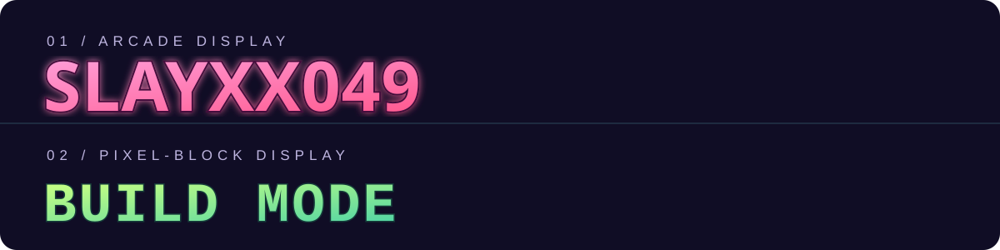

<!--
  Profile README draft for slayxx049.
  The banner is maintained in this repository: assets/vice-city-banner.svg
-->

  

<h1 align="center">HEY, I'M SLAYXX049</h1>

  <b>BUILDING THINGS. BREAKING PROBLEMS DOWN. LEARNING BY DOING.</b>

  
  

---

## ABOUT THIS DEVELOPER

I'm a CSE student interested in programming, AI/ML, and cybersecurity. I like experimenting with ideas, building practical projects, and learning how systems work by making things.

- Exploring software development and problem-solving.
- Interested in AI/ML and ethical cybersecurity.
- Prefer building and testing over pretending to know everything.
- This profile is my public build log — projects, experiments, and progress.

## THE TOOLKIT

  
  
  
  
  
  
  

## GAME-STYLE TYPE

  

Arcade-display and pixel-block inspired treatments. GitHub profile READMEs do not load repository font files as website CSS, so these are visual approximations rather than embedded Pricedown or Minecraft font files.

## THINGS I'VE PUT TOGETHER

| PROJECT | WHAT IT IS |
|:--|:--|
| [AI Job Finder](https://ai-j0b-finder.streamlit.app/) | A job discovery and matching app built with Python and cloud-backed services. |
| [Daily Mini Bytes](https://github.com/slayxx049/dmb_web_daily-mini-byte) | A news, blog, and technology platform. |
| [Portfolio / Build Log](https://github.com/slayxx049/build-port) | My personal portfolio and record of coding and building experiments. |

## GITHUB ACTIVITY

  
  

  

---

  <b>GOT AN INTERESTING IDEA?</b> 
  <a href="https://github.com/slayxx049">LET'S CONNECT ON GITHUB</a>

  Made of curiosity, commits, and a little retro neon.

